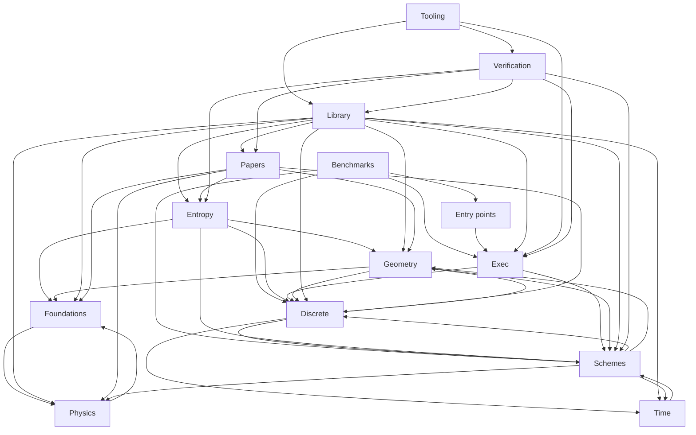

<!-- Generated file. Edit its sources and rerun python3 scripts/generate_import_graph.py. -->
# CFD_Lean architecture graph

An arrow points from the importing layer to the layer it depends on. Layer edges summarize direct imports between distinct layers.

The module graph contains 246 modules and 675 direct imports from the library, entry points, verification, benchmarks and tooling. The generator checks that the mathematical layers have no direct imports from Exec.

[Architecture guide](../ARCHITECTURE.md) · [GRAPHML](generated/graphs/imports.graphml) · [DOT](generated/graphs/imports.dot) · [JSON](generated/graphs/imports.json) · [Layer data](generated/imports.json) · [Mermaid source](generated/imports.mmd)

## Imports between layers

| Importing layer | Imported layer | Direct module imports |
| --- | --- | ---: |
| Benchmarks | Discrete | 5 |
| Benchmarks | Entry points | 1 |
| Benchmarks | Exec | 6 |
| Benchmarks | Schemes | 1 |
| Discrete | Geometry | 1 |
| Discrete | Schemes | 4 |
| Discrete | Time | 1 |
| Entropy | Discrete | 1 |
| Entropy | Foundations | 1 |
| Entropy | Geometry | 1 |
| Entropy | Schemes | 2 |
| Entry points | Exec | 2 |
| Exec | Discrete | 3 |
| Exec | Schemes | 10 |
| Foundations | Physics | 1 |
| Geometry | Discrete | 2 |
| Geometry | Foundations | 1 |
| Geometry | Schemes | 1 |
| Library | Discrete | 20 |
| Library | Entropy | 6 |
| Library | Exec | 20 |
| Library | Foundations | 3 |
| Library | Geometry | 11 |
| Library | Papers | 1 |
| Library | Physics | 8 |
| Library | Schemes | 28 |
| Library | Time | 4 |
| Papers | Discrete | 9 |
| Papers | Entropy | 5 |
| Papers | Foundations | 3 |
| Papers | Geometry | 18 |
| Papers | Physics | 1 |
| Physics | Foundations | 1 |
| Schemes | Discrete | 11 |
| Schemes | Geometry | 3 |
| Schemes | Physics | 4 |
| Schemes | Time | 2 |
| Time | Schemes | 2 |
| Tooling | Exec | 1 |
| Tooling | Library | 2 |
| Tooling | Verification | 1 |
| Verification | Entropy | 1 |
| Verification | Exec | 21 |
| Verification | Library | 2 |
| Verification | Papers | 86 |
| Verification | Schemes | 6 |
