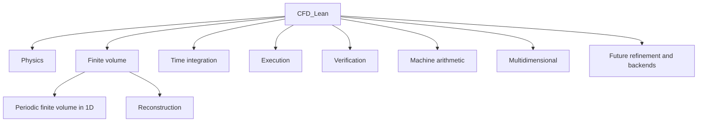

<!-- Generated file. Edit its sources and rerun `python3 scripts/generate_capabilities.py`. -->
# CFD_Lean capabilities

The registry records the status of each capability at the checked-out revision. Acceptance applies to the linked results and their stated hypotheses. Exact-real refinement and native arithmetic have separate evidence.

✅ Accepted · 🟡 Implemented / awaiting acceptance · 🧪 Proposal or scientific review · ⬜ Planned

[GRAPHML](generated/graphs/capabilities.graphml) · [DOT](generated/graphs/capabilities.dot) · [JSON](generated/graphs/capabilities.json)
 · [Full Mermaid source](generated/capabilities.mmd)

## Capability evidence

| Capability | Status | Evidence and documentation |
| --- | --- | --- |
| Scalar Burgers flux and Rusanov consistency | ✅ Accepted | [B0-F](../specifications/Burgers-B0-results.json), [Burgers-B0.md](../references/Burgers-B0.md) |
| Ideal-gas Euler state, admissibility and physical flux | ✅ Accepted | [M1](../specifications/M1.md), [M1.md](../references/M1.md) |
| Uniform Burgers and Euler Rusanov step | ✅ Accepted | [FV1D](../specifications/FV1D-results.json), [Acceptance.md](../reviews/FV1D/Acceptance.md) |
| Nonuniform geometry and exact-real updates | 🟡 Implemented / awaiting acceptance | [FVN](../specifications/FV1D-nonuniform-results.json), [FV1D-nonuniform.md](../references/FV1D-nonuniform.md) |
| First-order Euler positivity under CFL hypotheses | ✅ Accepted | [FVP](../specifications/FV1D-positivity-results.json), [Acceptance.md](../reviews/FVP/Acceptance.md) |
| Piecewise-constant traces (first order) | ✅ Accepted | [FV1D](../specifications/FV1D-results.json) |
| Uniform Burgers MUSCL and limiter certificates | ✅ Accepted | [B3](../specifications/Burgers-B3-results.json), [B3b](../specifications/Burgers-B3b-results.json), [E0c](../specifications/Burgers-E0c-results.json), [Burgers-B3b.md](../references/Burgers-B3b.md) |
| Shared oriented-trace interface | 🟡 Implemented / awaiting acceptance | [U-C](../specifications/FV1D-WENO-reconstruction-results.json), [U-M](../specifications/FV1D-WENO-reconstruction-results.json), [FV1D-WENO-reconstruction.md](../references/FV1D-WENO-reconstruction.md) |
| Burgers WENO and graded reconstruction | 🟡 Implemented / awaiting acceptance | [U-W](../specifications/FV1D-WENO-reconstruction-results.json), [G-P](../specifications/FV1D-WENO-reconstruction-results.json), [G-I](../specifications/FV1D-WENO-reconstruction-results.json), [B-F](../specifications/FV1D-WENO-reconstruction-results.json), [B-3](../specifications/FV1D-WENO-reconstruction-results.json), [FV1D-WENO-reconstruction.md](../references/FV1D-WENO-reconstruction.md) |
| Reconstructed Euler traces and executable steps | 🟡 Implemented / awaiting acceptance | [FVT](../specifications/FV1D-euler-traces-results.json), [E-T](../specifications/FV1D-WENO-reconstruction-results.json), [E-F](../specifications/FV1D-WENO-reconstruction-results.json), [E-A](../specifications/FV1D-WENO-reconstruction-results.json), [E-P](../specifications/FV1D-WENO-reconstruction-results.json), [E-D](../specifications/FV1D-WENO-reconstruction-results.json), [E-R](../specifications/FV1D-WENO-reconstruction-results.json), [FV1D-euler-traces.md](../references/FV1D-euler-traces.md) |
| Forward Euler (periodic exact-real step) | ✅ Accepted | [FV1D](../specifications/FV1D-results.json), [B1](../specifications/Burgers-B1-results.json) |
| SSPRK2 (scalar exact-real composition) | ✅ Accepted | [B2](../specifications/Burgers-B2-results.json) |
| SSPRK3 (scalar exact-real composition) | ✅ Accepted | [B2](../specifications/Burgers-B2-results.json) |
| Burgers array kernels and exact-real refinement | ✅ Accepted | [E0](../specifications/Burgers-E0-results.json), [E0b](../specifications/Burgers-E0b-results.json), [E0c](../specifications/Burgers-E0c-results.json) |
| Uniform and nonuniform FV1D array refinement | ✅ Accepted | [FVA](../specifications/FV1D-array-results.json), [FVNA](../specifications/FV1D-nonuniform-array-results.json), [Acceptance.md](../reviews/FVNA/Acceptance.md) |
| Native Float / binary64 execution | 🟡 Implemented / awaiting acceptance | [README.md](../CFDLean/Exec/README.md), [FVMain.lean](../FVMain.lean) |
| Trusted statements and proof bridges | 🟡 Implemented / awaiting acceptance | [BurgersB0Challenge.lean](../CFDLean/Verification/BurgersB0Challenge.lean), [BurgersB0Verify.lean](../CFDLean/Verification/BurgersB0Verify.lean) |
| Comparator, catalog and evidence | 🟡 Implemented / awaiting acceptance | [BurgersB0.comparator.json](../Challenges/BurgersB0.comparator.json), [verify.py](../scripts/verify.py), [README.md](../catalog/README.md) |
| E1 one-step binary64 certificate and native replay | 🟡 Implemented / awaiting acceptance | [E1](../specifications/E1-results.json), [E1.md](../references/E1.md) |
| Median-dual Euler/Roe residual and boundaries | ✅ Accepted | [M2](../specifications/M2-results.json), [M3](../specifications/M3-results.json), [M4](../specifications/M4-results.json), [Euler-Milestones.md](../references/Euler-Milestones.md) |
| Median-dual Euler explicit update | 🟡 Implemented / awaiting acceptance | [M5](../specifications/M5-results.json), [M5.md](../references/M5.md) |
| Oriented-face two-triangle control | 🟡 Implemented / awaiting acceptance | [Two_Triangle_Freeze.md](../reviews/FV2D/Two_Triangle_Freeze.md), [OrientedTriangles.lean](../benchmarks/ReviewCases/OrientedTriangles.lean) |
| Fixed-mesh conservative assembly and update | ✅ Accepted | [MD](../specifications/MD-fixed-mesh-assembly-results.json), [MD-fixed-mesh-assembly.md](../references/MD-fixed-mesh-assembly.md), [Acceptance.md](../reviews/MD/Acceptance.md) |
| Generic fixed-mesh multidimensional FV schemes | ⬜ Planned | [NEXT.md](../roadmap/NEXT.md) |
| ALE | ⬜ Planned | [FUTURE.md](../roadmap/FUTURE.md) |
| AMR | ⬜ Planned | [FUTURE.md](../roadmap/FUTURE.md) |
| MPI | ⬜ Planned | [FUTURE.md](../roadmap/FUTURE.md) |
| GPU | ⬜ Planned | [FUTURE.md](../roadmap/FUTURE.md) |
| JST paper 1 formalization | 🧪 Proposal or scientific review | [JST1](../specifications/JST1/P1-results.json), [README.md](../specifications/JST1/README.md) |

## Next architectural steps

- Generic fixed-mesh multidimensional FV schemes
- ALE
- AMR
- MPI
- GPU
