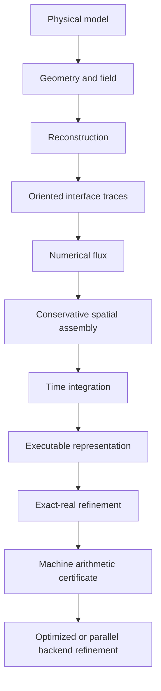

# Building blocks

Follow one oriented face in the periodic FV1D Rusanov step. The physical model gives a state and physical flux. Geometry gives the owner, neighbor, orientation and measures. The field gives each cell's mean state. Reconstruction supplies the two states seen by the face. The numerical flux makes one oriented transfer from those traces. Conservative assembly gives the transfer opposite signs in the two adjacent cells, then divides the net amount by each cell's measure. A time integrator composes those spatial updates.

| Block | Interface to look for |
| --- | --- |
| Physics | A conserved state, admissibility predicate and physical flux. Wave-speed and entropy capabilities are separate obligations. [Euler state](../../CFDLean/Physics/Euler/State.lean) · [Burgers flux](../../CFDLean/Physics/Burgers/Flux.lean) |
| Topology, geometry and field | Connectivity and orientation, cell and face measures, then the values indexed by that mesh. [Periodic mesh](../../CFDLean/Discrete/Periodic/Mesh1D.lean) · [Median-dual geometry](../../CFDLean/Geometry/MedianDual/README.md) |
| Reconstruction | Map a field and its stencil to two oriented traces. First-order FV supplies cell means directly. [Oriented traces](../../CFDLean/Discrete/Periodic/Reconstruction.lean) |
| Numerical flux and assembly | Evaluate a two-point flux once per oriented face and add signed transfers. [Flux interface](../../CFDLean/Schemes/Scalar/NumericalFlux.lean) · [Periodic weighted assembly](../../CFDLean/Discrete/Periodic/Nonuniform.lean) |
| Time | Apply Forward Euler or compose stages under the hypotheses of the relevant SSP certificate. [Forward Euler](../../CFDLean/Time/ForwardEuler.lean) · [SSP](../../CFDLean/Time/SSP.lean) |
| Execution | Keep driver I/O and model selection outside the arithmetic-polymorphic array kernel. Refine the kernel over ℝ before attributing properties to another arithmetic backend. [Execution modules](../../CFDLean/Exec/README.md) |
| Arithmetic and parallelism | State the floating-point domain and error budget for a concrete backend. MPI and GPU refinements should preserve an already specified global numerical operator, including its interface orientation and conservation. [E1 scope](../../specifications/E1-burgers-step-proposal.md) · [Design principles](../../roadmap/PRINCIPLES.md) |

Burgers has real scalar states. Euler certificates refer to density and pressure admissibility. The cell-centered FV1D and node-centered median-dual Euler schemes use different control volumes. A reusable result should state the geometry and model hypotheses it actually uses.

For concrete file locations, use the [concept-to-code map](../CONCEPTS.md). The [trust chain](trust-chain.md) explains what each proof or replay can establish.
